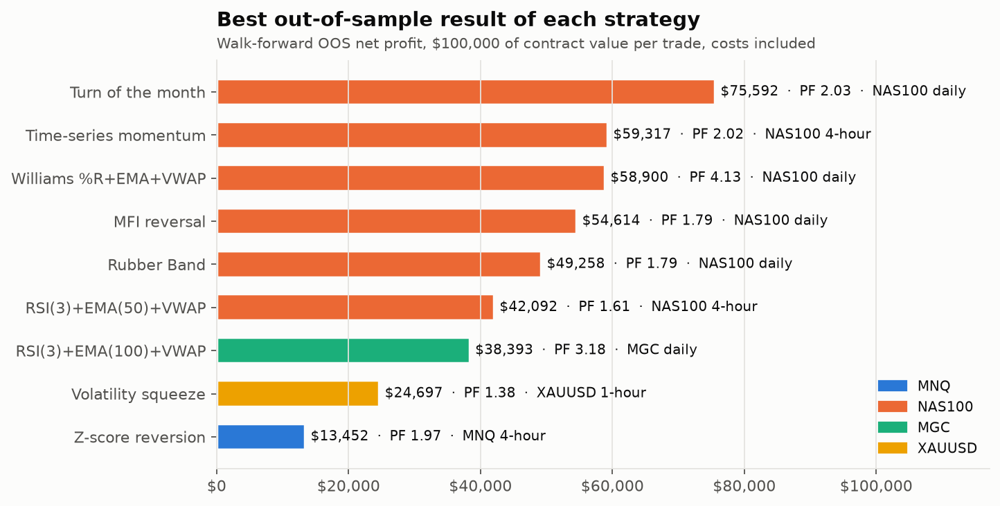
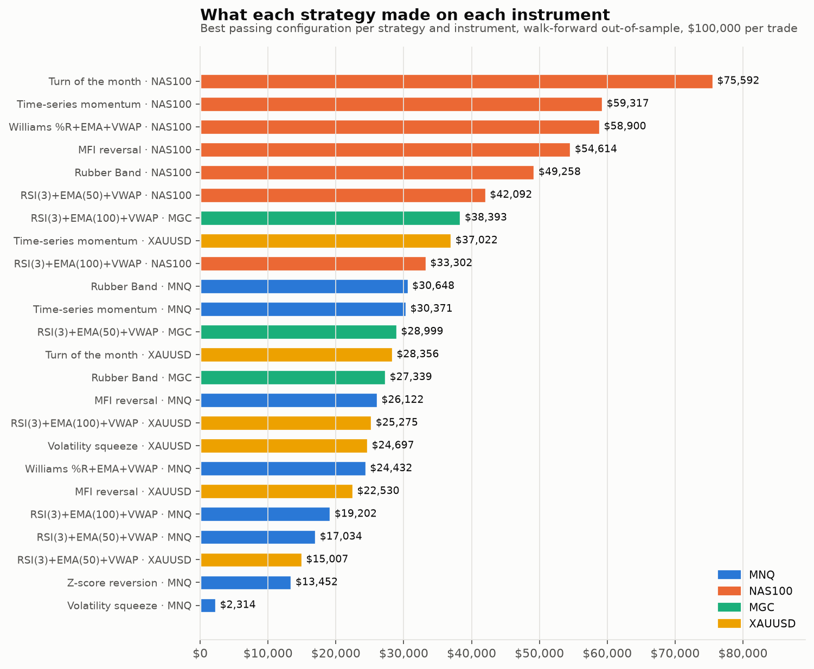
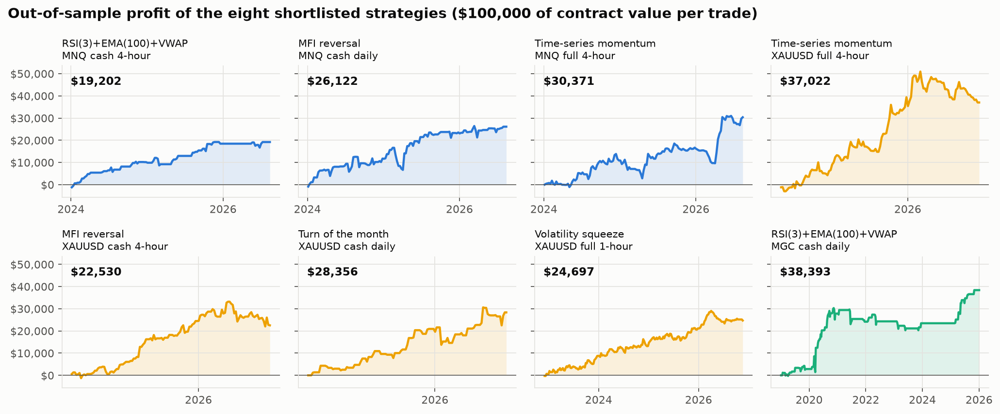
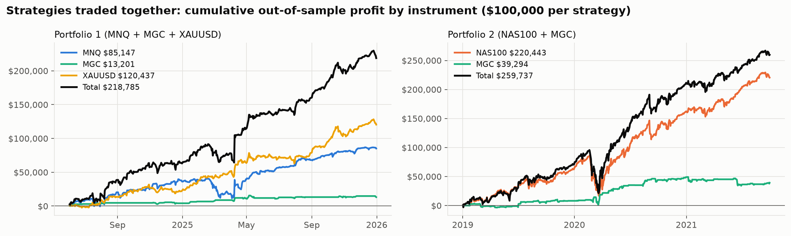
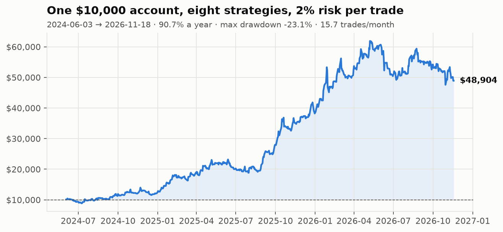
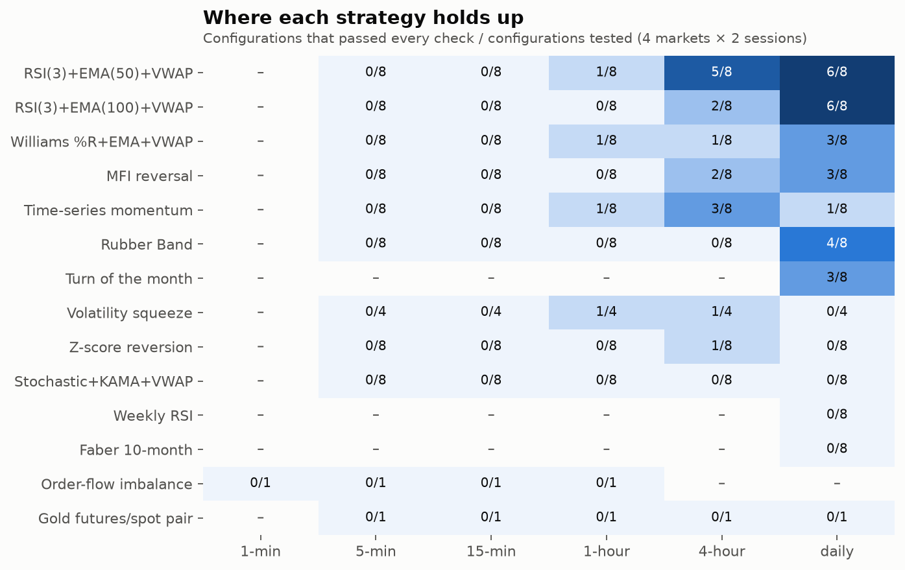
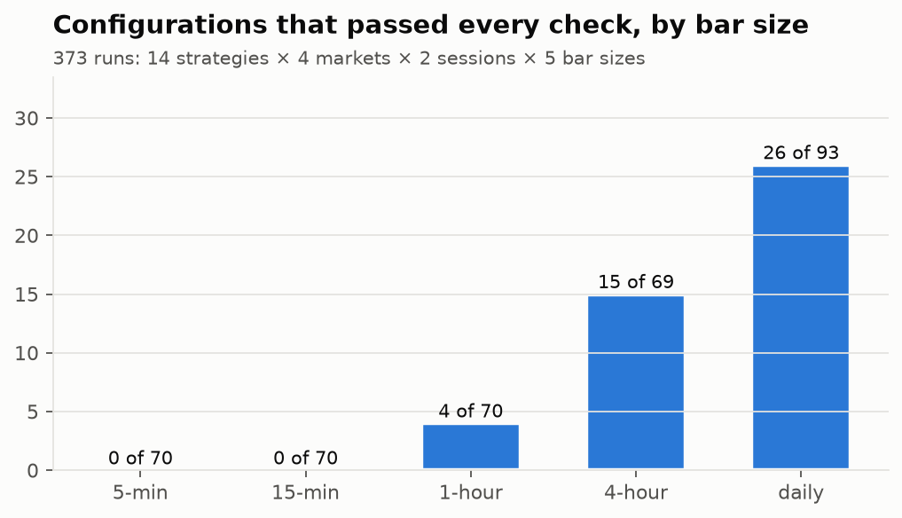
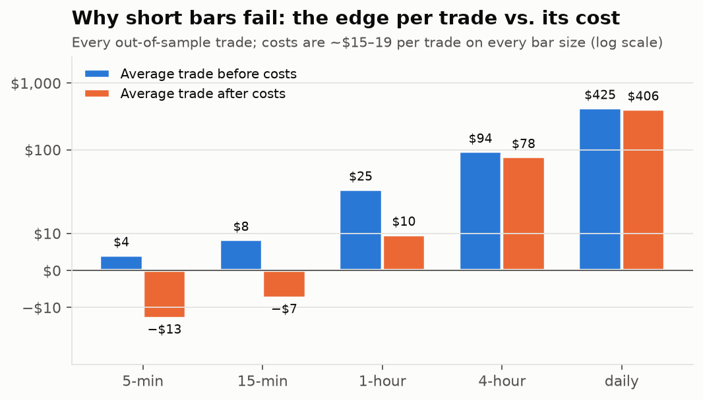

<div align="center">

# Walk-Forward Strategy Research Engine

**A from-scratch backtesting and robustness-testing platform in Python**
**for Nasdaq-100 and gold: futures, CFDs and spot, from 1-minute to daily bars.**


</div>

---

## Highlights

| | |
|---|---|
| 🏆 **Best out-of-sample result** | **+$75,592**, profit factor **2.03** (Turn of the month, NAS100 daily) |
| 🎯 **Highest out-of-sample profit factor** | **4.13** (Williams %R + EMA + VWAP, NAS100 daily, 83% win rate) |
| 📈 **Most consistent strategy** | Time-series momentum: profitable out-of-sample in **36 of 40** configurations |
| 🧪 **Scale of testing** | **611 backtests** · 14 strategies · 4 instruments · 6 bar sizes · 2 sessions · 0 errors |
| ✅ **Robust configurations** | **47** passed every robustness check on data the optimiser never saw |
| 💼 **Multi-strategy portfolio** | **32.1 trades / month**, **+$218,785** out-of-sample in 18.9 months |
| 💰 **$10,000 account** | **$48,904** in 29.5 months, **90.7% a year** compounded |
| 🔬 **Engineering** | 224 automated tests · look-ahead protection · 10 independent code-audit rounds |

<p align="center"></p>

---

## Contents

1. [Results by instrument](#1-results-by-instrument)
2. [Multi-strategy portfolios](#2-multi-strategy-portfolios)
3. [One $10,000 account](#3-one-10000-account)
4. [The strategies: exact rules and results](#4-the-strategies-exact-rules-and-results)
5. [Variations tested](#5-variations-tested)
6. [What didn't work, and why](#6-what-didnt-work-and-why)
7. [How the engine works](#7-how-the-engine-works)
8. [Bugs found and fixed](#8-bugs-found-and-fixed)
9. [Every configuration that passed](#9-every-configuration-that-passed)
10. [Running it](#10-running-it)
11. [Result files and downloads](#11-result-files-and-downloads)

All profit figures use the same standard sizing unless stated otherwise: **$100,000 of contract value per trade**,
with commission, slippage, bid/ask spreads and futures roll costs included. **OOS** = walk-forward out-of-sample:
parameters chosen on earlier data only, then traded on the following window the optimiser never saw.
**PF** = profit factor (gross profit ÷ gross loss).

---

## 1. Results by instrument

| Instrument | Configurations that passed every check | Strategies that passed | Best strategy | Best OOS net | OOS PF |
|---|---|---|---|---|---|
| **NAS100** | 15 of 91 | 7 | Turn of the month (daily) | **+$75,592** | 2.03 |
| **MNQ** | 16 of 95 | 8 | Rubber Band (daily) | **+$30,648** | 6.27 |
| **XAUUSD** | 8 of 91 | 6 | Time-series momentum (4-hour) | **+$37,022** | 1.89 |
| **MGC** | 6 of 96 | 3 | RSI(3)+EMA(100)+VWAP (daily) | **+$38,393** | 3.18 |

<p align="center"></p>

### NAS100 (Nasdaq-100 CFD, 2012–2021, 9.7 years)

| Strategy | Session · bars | OOS net | OOS PF | OOS trades | Full-history net | PF | Win % | Avg win ÷ avg loss | Trades / month | Max drawdown |
|---|---|---|---|---|---|---|---|---|---|---|
| Turn of the month | full · daily | **+$75,592** | 2.03 | 80 | +$85,479 | 1.98 | 66.4 | 1.00 | 1.0 | −$15,514 |
| Time-series momentum | cash · 4-hour | **+$59,317** | 2.02 | 77 | +$46,595 | 1.79 | 50.8 | 1.74 | 0.6 | −$17,755 |
| Williams %R+EMA+VWAP | cash · daily | **+$58,900** | 4.13 | 55 | +$72,907 | 2.80 | 83.3 | 0.56 | 0.6 | −$26,074 |
| MFI reversal | cash · daily | **+$54,614** | 1.79 | 115 | +$107,309 | 1.97 | 72.8 | 0.74 | 2.1 | −$23,409 |
| Rubber Band | cash · daily | **+$49,258** | 1.79 | 103 | +$45,019 | 1.81 | 72.5 | 0.69 | 0.8 | −$26,368 |
| RSI(3)+EMA(50)+VWAP | full · 4-hour | **+$42,092** | 1.61 | 257 | +$29,786 | 1.53 | 75.4 | 0.50 | 2.1 | −$9,336 |
| RSI(3)+EMA(100)+VWAP | cash · daily | **+$33,302** | 1.90 | 70 | +$70,053 | 3.53 | 80.8 | 0.84 | 0.7 | −$11,628 |

### MNQ (Micro Nasdaq-100 futures, 2021–2026, 5.6 years)

| Strategy | Session · bars | OOS net | OOS PF | OOS trades | Full-history net | PF | Win % | Avg win ÷ avg loss | Trades / month | Max drawdown |
|---|---|---|---|---|---|---|---|---|---|---|
| Rubber Band | full · daily | **+$30,648** | 6.27 | 18 | +$41,120 | 3.18 | 77.3 | 0.93 | 0.7 | −$14,178 |
| Time-series momentum | full · 4-hour | **+$30,371** | 1.88 | 95 | +$19,964 | 1.23 | 37.4 | 2.05 | 2.1 | −$21,410 |
| MFI reversal | cash · daily | **+$26,122** | 2.00 | 62 | +$51,354 | 1.68 | 65.9 | 0.87 | 2.0 | −$12,325 |
| Williams %R+EMA+VWAP | full · daily | **+$24,432** | 2.90 | 40 | +$31,437 | 3.09 | 78.6 | 0.84 | 0.4 | −$13,170 |
| RSI(3)+EMA(100)+VWAP | cash · 4-hour | **+$19,202** | 3.86 | 40 | +$48,244 | 3.22 | 75.2 | 1.06 | 1.6 | −$7,900 |
| RSI(3)+EMA(50)+VWAP | full · daily | **+$17,034** | 7.50 | 20 | +$20,476 | 4.57 | 82.8 | 0.95 | 0.4 | −$5,361 |
| Z-score reversion | cash · 4-hour | **+$13,452** | 1.97 | 34 | +$14,232 | 1.14 | 59.5 | 0.77 | 2.5 | −$23,807 |
| Volatility squeeze | full · 4-hour | **+$2,314** | 5.88 | 6 | +$4,390 | 4.45 | 70.6 | 1.85 | 0.2 | −$952 |

### XAUUSD (spot gold, 2021–2026, 5.4 years)

| Strategy | Session · bars | OOS net | OOS PF | OOS trades | Full-history net | PF | Win % | Avg win ÷ avg loss | Trades / month | Max drawdown |
|---|---|---|---|---|---|---|---|---|---|---|
| Time-series momentum | full · 4-hour | **+$37,022** | 1.89 | 84 | +$53,185 | 2.10 | 47.4 | 2.33 | 1.2 | −$25,400 |
| Turn of the month | cash · daily | **+$28,356** | 2.74 | 29 | +$34,013 | 1.74 | 59.4 | 1.19 | 1.0 | −$18,749 |
| RSI(3)+EMA(100)+VWAP | full · daily | **+$25,275** | 3.68 | 18 | +$21,954 | 2.38 | 77.4 | 0.69 | 0.5 | −$17,256 |
| Volatility squeeze | full · 1-hour | **+$24,697** | 1.38 | 305 | +$13,695 | 1.16 | 45.8 | 1.38 | 5.9 | −$11,215 |
| MFI reversal | cash · 4-hour | **+$22,530** | 1.48 | 124 | +$12,569 | 1.10 | 65.2 | 0.59 | 6.5 | −$22,909 |
| RSI(3)+EMA(50)+VWAP | cash · daily | **+$15,007** | 2.57 | 15 | +$14,726 | 2.00 | 68.2 | 0.94 | 0.3 | −$12,954 |

### MGC (Micro gold futures, 2016–2025, 10 years)

| Strategy | Session · bars | OOS net | OOS PF | OOS trades | Full-history net | PF | Win % | Avg win ÷ avg loss | Trades / month | Max drawdown |
|---|---|---|---|---|---|---|---|---|---|---|
| RSI(3)+EMA(100)+VWAP | cash · daily | **+$38,393** | 3.18 | 44 | +$31,489 | 2.30 | 69.8 | 0.99 | 0.4 | −$9,682 |
| RSI(3)+EMA(50)+VWAP | cash · daily | **+$28,999** | 2.45 | 42 | +$19,747 | 2.03 | 66.7 | 1.01 | 0.3 | −$9,235 |
| Rubber Band | cash · daily | **+$27,339** | 1.47 | 121 | +$18,243 | 1.21 | 61.2 | 0.77 | 1.4 | −$22,203 |

### Intraday (flat every day by 15:55 ET)

| Strategy | Instrument | Bars | Trades / month | Win % | Avg win ÷ avg loss | PF | Full-history net | OOS net | OOS PF |
|---|---|---|---|---|---|---|---|---|---|
| Time-series momentum | MNQ | 15-min | 10.2 | 54.9 | 1.00 | 1.23 | +$33,112 | **+$25,502** | 1.26 |
| Volatility squeeze | XAUUSD | 1-hour | 1.4 | 56.8 | 1.56 | 2.05 | +$4,004 | **+$3,900** | 1.62 |

<p align="center"></p>

---

## 2. Multi-strategy portfolios

One passing configuration per strategy and instrument (chosen by trade frequency, not by profit), all traded at the
same time, each with $100,000 of contract value per trade, measured only on dates where every strategy was in its
out-of-sample period.

|  | Portfolio 1: MNQ + MGC + XAUUSD | Portfolio 2: NAS100 + MGC |
|---|---|---|
| Period | 2024-06-03 → 2025-12-31 (18.9 months) | 2019-01-02 → 2021-09-30 (32.9 months, incl. COVID crash) |
| Strategies | 15 | 10 |
| Trades entered | 608 | 731 |
| **Trades per month** | **32.1** | **22.2** |
| **Net profit** | **+$218,785** | **+$259,737** |
| Max drawdown (daily closes) | −$27,165 | −$74,233 |
| Profitable months | 15 of 19 | 23 of 33 |
| Best month | 2025-04 → 37,186 | 2020-04 → 42,284 |
| Most positions open at once | 9 | 7 |

**Profit by instrument:**

| Portfolio | MNQ | NAS100 | MGC | XAUUSD | Total |
|---|---|---|---|---|---|
| Portfolio 1 | +$85,147 | — | +$13,201 | +$120,437 | **+$218,785** |
| Portfolio 2 | — | +$220,443 | +$39,294 | — | **+$259,737** |

<p align="center"></p>

<details>
<summary><b>Profit of every strategy in the portfolios</b></summary>

**Portfolio 1 (MNQ + MGC + XAUUSD)**

| Strategy · instrument · session · bars | Net profit |
|---|---|
| Time-series momentum · XAUUSD full 4-hour | +$35,404 |
| RSI(3)+EMA(100)+VWAP · XAUUSD cash daily | +$23,585 |
| MFI reversal · XAUUSD cash 4-hour | +$23,309 |
| Rubber Band · MNQ full daily | +$20,094 |
| Turn of the month · XAUUSD cash daily | +$19,225 |
| MFI reversal · MNQ cash daily | +$15,032 |
| Time-series momentum · MNQ full 4-hour | +$14,290 |
| Rubber Band · MGC cash daily | +$13,201 |
| RSI(3)+EMA(100)+VWAP · MNQ cash 4-hour | +$12,835 |
| RSI(3)+EMA(50)+VWAP · XAUUSD cash 4-hour | +$9,956 |
| Volatility squeeze · XAUUSD full 1-hour | +$8,957 |
| Williams %R+EMA+VWAP · MNQ cash 1-hour | +$8,759 |
| Z-score reversion · MNQ cash 4-hour | +$8,262 |
| RSI(3)+EMA(50)+VWAP · MNQ full 4-hour | +$5,232 |
| Volatility squeeze · MNQ full 4-hour | +$644 |

**Portfolio 2 (NAS100 + MGC)**

| Strategy · instrument · session · bars | Net profit |
|---|---|
| Turn of the month · NAS100 cash daily | +$42,148 |
| RSI(3)+EMA(50)+VWAP · NAS100 full 4-hour | +$36,658 |
| RSI(3)+EMA(100)+VWAP · NAS100 full 4-hour | +$36,501 |
| Rubber Band · NAS100 cash daily | +$33,913 |
| Williams %R+EMA+VWAP · NAS100 cash daily | +$28,988 |
| Time-series momentum · NAS100 cash 1-hour | +$22,892 |
| MFI reversal · NAS100 full 4-hour | +$19,343 |
| Rubber Band · MGC cash daily | +$18,535 |
| RSI(3)+EMA(100)+VWAP · MGC full daily | +$16,305 |
| RSI(3)+EMA(50)+VWAP · MGC cash 4-hour | +$4,455 |

</details>

---

## 3. One $10,000 account

Eight strategies on one shared $10,000 account, compounding. Each position is sized so that a 2 × ATR(14) move
against it costs 2% of the current balance, rounded down to whole micro contracts or 0.01 lots.

| Period | $10,000 → | Per year | Max drawdown | Trades / month | Win rate | Avg win / loss | PF | Profitable months |
|---|---|---|---|---|---|---|---|---|
| 2024-06-03 → 2026-11-18 (29.5 months) | **$48,904** | **90.7%** | -23.1% | 15.7 | 50.8% | +1.08R / -0.69R | 1.44 | 22 of 30 |

<p align="center"></p>

| Strategy in the account | Trades taken | Net profit | Win % |
|---|---|---|---|
| Volatility squeeze XAUUSD full 1-hour | 193 | +$12,416 | 45.6 |
| Time-series momentum XAUUSD full 4-hour | 84 | +$12,024 | 36.9 |
| Turn of the month XAUUSD cash daily | 29 | +$5,834 | 62.1 |
| MFI reversal XAUUSD cash 4-hour | 124 | +$4,695 | 70.2 |
| Time-series momentum MNQ full 4-hour | 31 | +$4,485 | 32.3 |
| RSI(3)+EMA(100)+VWAP MGC cash daily | 0 | +$0 | — |
| MFI reversal MNQ cash daily | 0 | +$0 | — |
| RSI(3)+EMA(100)+VWAP MNQ cash 4-hour | 2 | −$550 | 50.0 |

By instrument: XAUUSD +$34,969, MNQ +$3,935, MGC +$0.
At $10,000 a single MNQ or MGC micro contract often carries more than 2% risk, so those trades are only taken once
the balance has grown enough to size them.

---

## 4. The strategies: exact rules and results

Every rule below is the exact logic in `strategies/`. Signals are evaluated on a bar's close and **every order fills
at the next bar's open** (or at its stop/limit price inside a bar). Defaults are shown; the grid lists every value
tested in the parameter search and re-optimised in each walk-forward window.

### 1 · RSI(3) + EMA(50) + VWAP — long only · 12 configurations passed (most robust)
- **Entry:** RSI(3) < 22 **and** close above EMA(50) **and** close below the 10-bar rolling VWAP.
- **Exit:** RSI(3) > 55.
- **Grid:** RSI entry 15 / 22 / 30 · RSI exit 50 / 55 / 65 · EMA 50 / 100.
- **Passed on all four instruments:** NAS100 4-hour **+$42,092** (PF 1.61), MGC daily +$28,999 (PF 2.45), MNQ daily
  +$17,034 (**PF 7.50**), XAUUSD daily +$15,007 (PF 2.57). 6 daily, 5 four-hour and 1 one-hour configuration passed.

### 2 · RSI(3) + EMA(100) + VWAP pullback — long only · 8 passed
- **Entry:** RSI(3) < 22 **and** EMA(100) rising (above its value 5 bars earlier) **and** close at least 1% below the
  10-bar rolling VWAP.
- **Exit:** RSI(3) > 55.
- **Grid:** RSI entry 15 / 22 / 30 · RSI exit 50 / 55 / 65 · VWAP discount 0.5% / 1.0% / 1.5%.
- **Passed on all four instruments:** MGC daily **+$38,393 (PF 3.18)**, NAS100 daily +$33,302, XAUUSD daily +$25,275
  (PF 3.68), MNQ 4-hour +$19,202 (PF 3.86, 75% win rate).

### 3 · Williams %R + EMA + VWAP — long only · 5 passed
- **Entry:** Williams %R(10) < −80 **and** close above EMA(200) **and** close below the 10-bar VWAP.
- **Exit:** %R > −20.
- **Grid:** %R length 2 / 5 / 10 · entry −90 / −80 / −70 · exit −50 / −20.
- **Results:** NAS100 daily **+$58,900, PF 4.13, 83% win rate**; MNQ daily +$24,432 (PF 2.90); MNQ 1-hour +$18,655.

### 4 · MFI reversal — long only · 5 passed
- **Entry:** 2-bar Money Flow Index < 10.
- **Exit:** close above the previous bar's high.
- **Grid:** MFI length 2 / 3 / 5 · entry level 5 / 10 / 20.
- **Results:** NAS100 daily **+$54,614** (full history **+$107,309**); NAS100 4-hour +$34,135 at **9.9 trades a
  month**, the most active robust configuration; MNQ daily +$26,122; XAUUSD 4-hour +$22,530 at 6.5 trades a month.

### 5 · Time-series momentum — long only · 5 passed + 1 intraday
- **Entry:** 20-bar return above 5% (measured on the real, unadjusted price).
- **Exit:** close below the 50-bar simple moving average.
- **Grid:** lookback 20 / 60 · threshold 3% / 5% / 8% · exit average 50 / 100.
- **Results:** profitable out-of-sample in **36 of 40** configurations. NAS100 4-hour **+$59,317 (PF 2.02)**, NAS100
  1-hour +$49,998, XAUUSD 4-hour +$37,022, MNQ 4-hour +$30,371; intraday MNQ 15-minute +$25,502 at 10.2 trades a
  month. Wins about 40% of trades with winners about 2× the size of losers.

### 6 · Rubber Band — long only · 4 passed
- **Entry:** close below the band = highest high of the last 5 bars − 2.5 × the 10-bar average high-low range.
- **Exit:** close above the previous bar's high.
- **Grid:** high lookback 5 / 10 · range length 10 / 20 · multiplier 2.0 / 2.5 / 3.0.
- **Results (all daily):** NAS100 **+$49,258**, MNQ +$30,648 (**PF 6.27**), MGC +$27,339.

### 7 · Turn of the month — long only · 3 passed
- **Entry:** the close of the 5th-last trading day of the month (exchange calendar).
- **Exit:** the close of the 3rd trading day of the next month.
- **Grid:** entry 3 / 5 / 7 days before month-end · exit day 1 / 3 / 5.
- **Results:** NAS100 daily **+$75,592 (PF 2.03), the best result of the whole study**; NAS100 cash session
  +$60,950; XAUUSD daily +$28,356 (PF 2.74).

### 8 · Volatility squeeze breakout — long and short · 2 passed + 1 intraday
- **Setup:** Bollinger(20, 2) width in the lowest 10% of the last 200 bars.
- **Entry:** buy stop at the 20-bar high **and** sell stop at the 20-bar low (one cancels the other), valid 4 bars.
- **Exit:** stop-loss at the opposite side of the range · target 2 × the risk · or after 32 bars.
- **Grid:** squeeze percentile 5 / 10 / 20 · target 1.5 / 2 / 3 × risk.
- **Results:** XAUUSD 1-hour **+$24,697** at 5.9 trades a month; MNQ 4-hour PF 5.88; intraday XAUUSD 1-hour PF 1.62.

### 9 · Z-score mean reversion — long and short · 1 passed
- z = (close − 20-bar mean) ÷ 20-bar standard deviation.
- **Entry:** long when z < −2, short when z > +2. **Exit:** |z| < 0.5. **Stop:** |z| > 4.
- **Grid:** window 20 / 40 / 60 · entry 1.5 / 2.0 / 2.5 · exit 0 / 0.5.
- **Results:** MNQ 4-hour **+$13,452 (PF 1.97)**.

### 10 · Stochastic + KAMA + VWAP — long only
- **Entry:** Stochastic %K(21, smoothed 3) < 55 **and** close above KAMA(10, fast 3, slow 75) **and** close at least
  0.5% below the 200-bar rolling VWAP. **Exit:** %K back above 55, or after 25 bars.
- **Grid:** %K level 40 / 55 / 70 · VWAP buffer 0% / 0.5% / 1.0% · max hold 10 / 25.
- **Results:** profitable out-of-sample in 9 of 40 configurations (best NAS100 15-minute +$23,555), none passed.

### 11 · Weekly RSI — long only
- **Entry:** 2-week RSI < 15 (evaluated at week ends). **Exit:** weekly RSI(2) > 70.
- **Results:** profitable over the full history on **all 8** runs (median +$30,595, median PF 2.39); too few trades
  for walk-forward validation.

### 12 · Faber 10-month trend filter — long only
- At each month-end: hold if the close is above its 10-month simple moving average, otherwise flat.
- **Results:** profitable on **all 8** runs (median **+$97,725**, median PF 11.05); too few trades for walk-forward.

### 13 · Order-flow imbalance — long and short, intraday
- OFI = buyer-initiated − seller-initiated volume each minute. λ = rolling regression slope of the next minute's move
  on this minute's OFI (1,950-sample window). **Entry:** λ × OFI beyond ±2 ticks. **Exit:** after 2 bars; flat by
  the close; no entries in the last 10 minutes.
- **Results:** 25,176 trades; the predicted moves are smaller than the cost per trade.

### 14 · Gold futures vs spot gold pair (statistical arbitrage)
- Spread = gold futures − β × spot gold, β from a rolling 60-day regression; trade the spread's z-score (enter ±2,
  exit ±0.5, stop ±4). Runs on a dedicated two-leg engine.
- **Results:** the futures–spot gap is mostly interest-rate carry, which trends rather than reverts.

<p align="center"></p>

---

## 5. Variations tested

| Variation | What was done | Outcome |
|---|---|---|
| **Bar size** | Every strategy on 5-min, 15-min, 1-hour, 4-hour and daily bars (373 runs). Lengths stay in bars; thresholds in % of price are scaled by √(bar length ÷ original). | Passed: 1-hour 4, 4-hour 15, daily 26 |
| **Session** | New York cash session (09:30–16:00) and the full futures session, for every run. | Both produce passing configurations |
| **Instrument** | All four instruments for every single-market strategy. | Passing configurations on all four |
| **Parameters** | Full grid per run (up to 40 sets), re-optimised in every walk-forward window. | Best setting must sit on a plateau, not a lone spike |
| **Hard stop** | Every portfolio strategy re-run with a stop 2 × ATR(14) from the fill. | 21 of 22 profitable OOS; 4 made more with the stop |
| **Intraday** | Every strategy flat by 15:55 daily on 1-, 5-, 15-min and 1-hour bars (144 runs). | 2 passed, 22 profitable OOS |
| **4 pm exit** | Saved trades closed at the 16:00 cash close (replayed on 1-minute data, 160 exits verified independently). | Swing edge comes mostly from holding overnight |
| **Portfolio** | Robust configurations traded together. | 22.2–32.1 trades a month |
| **Account sizing** | One shared account, 2% of the balance at risk per trade, compounding. | $10,000 → $48,904 |

<p align="center"></p>

<details>
<summary><b>Hard 2 × ATR stop: every strategy, with and without</b></summary>

| Strategy | Instrument | Session · bars | OOS net, no stop | OOS net, with stop | OOS PF with stop | Passes every check with stop |
|---|---|---|---|---|---|---|
| RSI(3)+EMA(100)+VWAP | MNQ | cash · 4-hour | +$19,202 | +$18,048 | 2.71 | ✅ |
| Williams %R+EMA+VWAP | MNQ | cash · 1-hour | +$18,655 | −$5,607 | 0.92 | — |
| RSI(3)+EMA(50)+VWAP | MNQ | full · 4-hour | +$5,118 | +$5,301 | 1.97 | ✅ |
| Z-score reversion | MNQ | cash · 4-hour | +$13,452 | +$11,636 | 1.40 | — |
| Rubber Band | MNQ | full · daily | +$30,648 | +$31,571 | 4.12 | — |
| MFI reversal | MNQ | cash · daily | +$26,122 | +$16,322 | 1.87 | ✅ |
| Time-series momentum | MNQ | full · 4-hour | +$30,371 | +$29,334 | 1.82 | — |
| RSI(3)+EMA(100)+VWAP | XAUUSD | cash · daily | +$18,535 | +$15,919 | 1.89 | — |
| RSI(3)+EMA(50)+VWAP | XAUUSD | cash · 4-hour | +$14,933 | +$4,343 | 1.12 | — |
| Rubber Band | MGC | cash · daily | +$27,339 | +$42,205 | 1.56 | — |
| MFI reversal | XAUUSD | cash · 4-hour | +$22,530 | +$22,148 | 1.34 | — |
| Turn of the month | XAUUSD | cash · daily | +$28,356 | +$23,601 | 2.27 | ✅ |
| Time-series momentum | XAUUSD | full · 4-hour | +$37,022 | +$34,281 | 1.79 | — |
| RSI(3)+EMA(100)+VWAP | NAS100 | full · 4-hour | +$33,281 | +$29,680 | 1.25 | — |
| Williams %R+EMA+VWAP | NAS100 | cash · daily | +$58,900 | +$37,056 | 1.81 | ✅ |
| RSI(3)+EMA(50)+VWAP | NAS100 | full · 4-hour | +$42,092 | +$24,639 | 1.33 | — |
| Rubber Band | NAS100 | cash · daily | +$49,258 | +$34,898 | 1.31 | — |
| MFI reversal | NAS100 | full · 4-hour | +$34,135 | +$32,709 | 1.20 | — |
| Turn of the month | NAS100 | cash · daily | +$60,950 | +$26,937 | 1.33 | — |
| Time-series momentum | NAS100 | cash · 1-hour | +$49,998 | +$71,177 | 1.84 | ✅ |
| RSI(3)+EMA(100)+VWAP | MGC | full · daily | +$29,124 | +$28,620 | 1.69 | — |
| RSI(3)+EMA(50)+VWAP | MGC | cash · 4-hour | +$18,014 | +$12,352 | 1.38 | — |

</details>

<details>
<summary><b>Intraday study by bar size</b></summary>

| Bars | Runs | Median trades / month | Profitable OOS | Passed every check |
|---|---|---|---|---|
| 1-min | 36 | 35.1 | 0 | 0 |
| 5-min | 36 | 26.5 | 2 | 0 |
| 15-min | 36 | 9.6 | 11 | 1 |
| 1-hour | 36 | 3.6 | 9 | 1 |

</details>

---

## 6. What didn't work, and why

**Short bars lose to costs.** Every trade pays about $15–19 in commission, slippage and spread whatever the bar size,
while the average move per trade shrinks with the bar:

| Bars | Avg trade before costs | Avg costs | Avg trade after costs | Runs profitable before → after costs |
|---|---|---|---|---|
| 5-min | $4.14 | $17.05 | −$13 | 51 → 8 of 69 |
| 15-min | $8.31 | $15.70 | −$7.39 | 52 → 22 of 69 |
| 1-hour | $25 | $15.74 | +$9.68 | 52 → 37 of 66 |
| 4-hour | $94 | $15.78 | +$78 | 54 → 50 of 67 |
| daily | $425 | $19.01 | +$406 | 55 → 54 of 62 |

<p align="center"></p>

- **Intraday-only trading:** the swing strategies earn most of their edge while holding overnight; forced flat each
  day, the profit factor drops to about 1.1.
- **Order-flow imbalance:** predicted one-minute moves are smaller than the round-trip cost.
- **Gold futures/spot pair:** the spread follows interest-rate carry and drifts instead of reverting.
- **Weekly RSI and Faber 10-month:** profitable, but they trade a handful of times a year, too few for walk-forward
  validation.
- **A hard stop on dip-buying strategies** cuts trades that would have recovered; it helps the trend strategies more
  than the mean-reversion ones.

---

## 7. How the engine works

```
data (1-minute bars, bid/ask, futures rolls)
   │
   ▼
engine/core.py ─ bar-by-bar execution ── orders · fills · costs · rolls · account
   │
   ▼
robust.py ── 1 parameter grid + plateau check
          ── 2 walk-forward (optimise in-sample → trade unseen window → repeat)
          ── 3 Monte Carlo (5,000 bootstrap and shuffle resamples)
          ── 4 stress test (9 execution scenarios)
          ── 5 13-item checklist
   │
   ▼
*_study.py ── every strategy × instrument × session × bar size, in parallel, resumable
```

- **Execution engine** (`engine/core.py`): market, stop and limit orders, one-cancels-other, stop-loss, take-profit and
  R-multiple targets, risk-based or notional sizing, whole-contract rounding, absolute order deadlines, intraday orders.
  - Orders fill at the next bar's open or at their price inside the bar; when a stop and a target are both inside one
    bar the stop is assumed first (pessimistic).
  - Real bid/ask quotes for spot gold, the CFD's spread, commission plus 1 tick of slippage on futures.
  - **Futures rolls:** back-adjusted prices for signals, real prices for sizing, a roll charge whenever a position is
    held through a contract switch.
  - **Drawdown:** an exact walk of open → worst price → close on every bar.
  - **Account model:** an account that reaches $0 (at an open, a close or right after an entry's costs) is liquidated
    and stops trading.
- **Look-ahead protection** (`check_lookahead`): a run is refused if the strategy uses future data. Price columns can't
  be modified; indicators are recomputed on truncated data (fixed cuts, the first rows, signal flips and the
  strategy's own decision bars); strategy code runs on guarded data that raises on any read of a later bar.
- **Walk-forward:** 18 months in-sample → 6 out-of-sample for bars up to 1 hour; 36 → 12 for 4-hour and daily. The
  account balance carries across windows; a window with no valid setting trades nothing.
- **Stress scenarios:** commission × 2, slippage +1 and +2 ticks, spread × 1.5 / 2 / 3, 1- and 2-bar delays, and all
  combined.
- **"Passed every check":** profitable out-of-sample with PF ≥ 1.2, Monte Carlo chance of a loss under 10%, profitable
  in every stress scenario, the account never reached $0, and at most one of the 13 checklist items not passed
  (walk-forward efficiency counts only when enough windows were scored).
- **Pairs engine** (`engine/pairs.py`): two legs on common timestamps, hedge ratio, both legs' costs and rolls.
- **Studies** (`photo_study.py`, `timeframe_study.py`, `intraday_study.py`): parallel workers, safe concurrent writes,
  every result fingerprinted with the exact code and data versions that produced it.

---

## 8. Bugs found and fixed

The code went through ten independent audit rounds. Every problem was first reproduced as a failing test, then fixed;
all 224 tests stay in the suite.

| Area | Problem | Effect before the fix | Fix |
|---|---|---|---|
| Orders | Calling `close()` twice restarted the order delay | 669 false exits at midnight; the 1-bar-delay stress result was inflated by about $6,000 | The first close request is kept |
| Orders | When two breakout orders triggered in one bar, the buy was always checked first | Wrong side taken on ambiguous bars | The trigger nearest the open wins; verified against 1-second data |
| Orders | A target could be awarded from a high reached before a limit entry | Phantom winners | On the entry bar a limit's target needs the close through it |
| Sessions | The opening-range strategy ignored session hours | 37 trades crossed into the next day | Exchange calendar with holidays and half days; absolute entry deadline enforced by the engine |
| Look-ahead | The checker could be fooled by reverse slices, by reading data through the broker, and by a feature that peeks at only a few rows | Strategies using future data could pass | Index-exact guarded data; cuts at the strategy's own decision bars and signal flips |
| Look-ahead | One strategy inferred its bar size from the whole data set | On 1-hour bars its indicators changed when later data was added | Bar size inferred from past rows only |
| Data | Gold futures roll gaps were estimated with later rolls | Small look-ahead in every gold-futures result | Estimates from earlier rolls only |
| Data | The Money Flow Index used back-adjusted prices | Its value changed when a later roll rebased history | Computed on real traded prices |
| Sizing | Position size used back-adjusted futures prices | Wrong number of contracts | Sized on the real price of the contract held |
| Risk | Drawdown was measured only at bar closes | Losses inside a bar were hidden | Exact open → worst price → close walk |
| Risk | The account kept trading below $0 | One run took 753 more trades after going broke | Constrained account with breach detection at open, close and entry |
| Stress | Spread stress produced impossible bars | About 42,000 invalid gold bars at 2× spread | Bid and ask sides shift consistently |
| Walk-forward | Warm-up trades counted, capital reset each window, gaps between windows | Distorted out-of-sample results | Warm-up only computes indicators; balance carries over; windows are whole months |
| Metrics | Walk-forward efficiency could divide by near-zero in-sample profit | A meaningless score of 3,316 passed | Ratio withheld unless it is meaningful |
| Metrics | A breach in a single stress scenario didn't count as failing | 12 runs wrongly counted as surviving | Any breach in any scenario fails the run |
| Reports | Roll slippage was counted twice in the cost analysis | $7,658 added back twice | Exported as its own column |

**Independent verification:** trades rebuilt from the raw data with separate code matched the engine trade for trade
(turn of the month on NAS100: 114 of 114 identical to the cent), 1-minute fills were checked against 1-second data,
and every 4 pm exit price was re-derived independently (160 of 160 matched).

---

## 9. Every configuration that passed

<details>
<summary><b>All 45 swing configurations that passed every check (click to expand)</b></summary>

| Strategy | Instrument | Session · bars | Trades | Trades / month | Win % | Avg win ÷ avg loss | PF | Full-history net | Max drawdown | OOS trades | OOS net | OOS PF | Monte Carlo loss chance | Worst stress scenario |
|---|---|---|---|---|---|---|---|---|---|---|---|---|---|---|
| RSI(3)+EMA(100)+VWAP | MGC | cash · daily | 53 | 0.4 | 69.8 | 1.00 | 2.30 | +$31,489 | −$9,682 | 44 | **+$38,393** | 3.18 | 0.2% | +$45,913 |
| RSI(3)+EMA(100)+VWAP | MGC | full · daily | 56 | 0.5 | 71.4 | 0.70 | 1.75 | +$21,712 | −$13,490 | 56 | **+$29,124** | 2.28 | 1.4% | +$29,507 |
| RSI(3)+EMA(50)+VWAP | MGC | cash · daily | 39 | 0.3 | 66.7 | 1.01 | 2.03 | +$19,747 | −$9,235 | 42 | **+$28,999** | 2.45 | 1.0% | +$49,109 |
| Rubber Band | MGC | cash · daily | 170 | 1.4 | 61.2 | 0.76 | 1.21 | +$18,243 | −$22,203 | 121 | **+$27,339** | 1.47 | 7.8% | +$19,584 |
| RSI(3)+EMA(50)+VWAP | MGC | full · daily | 40 | 0.3 | 72.5 | 0.72 | 1.90 | +$19,113 | −$13,238 | 46 | **+$24,973** | 2.17 | 2.4% | +$42,333 |
| RSI(3)+EMA(50)+VWAP | MGC | cash · 4-hour | 134 | 1.1 | 68.7 | 0.70 | 1.53 | +$21,386 | −$12,414 | 76 | **+$18,014** | 1.67 | 4.9% | +$8,410 |
| Rubber Band | MNQ | full · daily | 44 | 0.7 | 77.3 | 0.93 | 3.18 | +$41,120 | −$14,178 | 18 | **+$30,648** | 6.27 | 0.4% | +$2,204 |
| Time-series momentum | MNQ | full · 4-hour | 139 | 2.1 | 37.4 | 2.05 | 1.23 | +$19,964 | −$21,410 | 95 | **+$30,371** | 1.88 | 9.4% | +$23,972 |
| MFI reversal | MNQ | cash · daily | 135 | 2.0 | 65.9 | 0.87 | 1.68 | +$51,354 | −$12,325 | 62 | **+$26,122** | 2.00 | 4.9% | +$39,194 |
| Williams %R+EMA+VWAP | MNQ | full · daily | 28 | 0.4 | 78.6 | 0.84 | 3.09 | +$31,437 | −$13,170 | 40 | **+$24,432** | 2.90 | 1.2% | +$15,369 |
| Time-series momentum | MNQ | cash · daily | 18 | 0.3 | 55.6 | 2.72 | 3.40 | +$44,240 | −$13,988 | 11 | **+$22,712** | 5.12 | 9.7% | +$32,250 |
| MFI reversal | MNQ | full · daily | 139 | 2.1 | 69.8 | 0.78 | 1.79 | +$55,574 | −$19,229 | 61 | **+$22,436** | 1.82 | 6.8% | +$52,230 |
| RSI(3)+EMA(100)+VWAP | MNQ | cash · 4-hour | 105 | 1.6 | 75.2 | 1.06 | 3.22 | +$48,244 | −$7,900 | 40 | **+$19,202** | 3.86 | 0.0% | +$34,810 |
| Williams %R+EMA+VWAP | MNQ | cash · 1-hour | 181 | 2.7 | 67.4 | 0.71 | 1.47 | +$26,433 | −$15,486 | 227 | **+$18,655** | 1.42 | 2.6% | +$21,380 |
| Williams %R+EMA+VWAP | MNQ | cash · daily | 28 | 0.4 | 75.0 | 0.62 | 1.85 | +$17,307 | −$13,467 | 53 | **+$17,388** | 1.99 | 6.0% | +$7,390 |
| RSI(3)+EMA(50)+VWAP | MNQ | full · daily | 29 | 0.4 | 82.8 | 0.95 | 4.57 | +$20,476 | −$5,361 | 20 | **+$17,034** | 7.50 | 0.0% | +$21,789 |
| RSI(3)+EMA(100)+VWAP | MNQ | full · daily | 40 | 0.6 | 77.5 | 0.74 | 2.54 | +$22,548 | −$10,251 | 32 | **+$16,066** | 2.20 | 7.8% | +$24,428 |
| Z-score reversion | MNQ | cash · 4-hour | 168 | 2.5 | 59.5 | 0.77 | 1.14 | +$14,232 | −$23,807 | 34 | **+$13,452** | 1.97 | 6.8% | +$27,492 |
| Williams %R+EMA+VWAP | MNQ | cash · 4-hour | 96 | 1.4 | 70.8 | 0.68 | 1.65 | +$27,196 | −$13,596 | 44 | **+$11,646** | 1.96 | 7.9% | +$18,902 |
| RSI(3)+EMA(50)+VWAP | MNQ | cash · 4-hour | 78 | 1.2 | 71.8 | 1.09 | 2.78 | +$26,626 | −$6,903 | 19 | **+$6,000** | 3.12 | 3.5% | +$22,106 |
| RSI(3)+EMA(50)+VWAP | MNQ | full · 4-hour | 147 | 2.2 | 72.1 | 0.50 | 1.28 | +$8,962 | −$10,466 | 38 | **+$5,118** | 1.95 | 7.1% | +$10,742 |
| Volatility squeeze | MNQ | full · 4-hour | 17 | 0.2 | 70.6 | 1.86 | 4.45 | +$4,390 | −$952 | 6 | **+$2,314** | 5.88 | 2.0% | +$1,605 |
| Turn of the month | NAS100 | full · daily | 116 | 1.0 | 66.4 | 1.00 | 1.98 | +$85,479 | −$15,514 | 80 | **+$75,592** | 2.03 | 1.7% | +$76,518 |
| Turn of the month | NAS100 | cash · daily | 115 | 1.0 | 63.5 | 1.08 | 1.88 | +$80,071 | −$20,494 | 80 | **+$60,950** | 1.82 | 4.1% | +$74,993 |
| Time-series momentum | NAS100 | cash · 4-hour | 65 | 0.6 | 50.8 | 1.74 | 1.79 | +$46,595 | −$17,755 | 77 | **+$59,317** | 2.02 | 1.0% | +$59,047 |
| Williams %R+EMA+VWAP | NAS100 | cash · daily | 66 | 0.6 | 83.3 | 0.56 | 2.80 | +$72,907 | −$26,074 | 55 | **+$58,900** | 4.13 | 0.0% | +$49,287 |
| MFI reversal | NAS100 | cash · daily | 239 | 2.1 | 72.8 | 0.74 | 1.97 | +$107,309 | −$23,409 | 115 | **+$54,614** | 1.79 | 0.8% | +$62,822 |
| Time-series momentum | NAS100 | cash · 1-hour | 200 | 1.7 | 44.0 | 2.15 | 1.69 | +$78,638 | −$14,183 | 161 | **+$49,998** | 1.70 | 1.3% | +$82,879 |
| Rubber Band | NAS100 | cash · daily | 98 | 0.8 | 72.5 | 0.69 | 1.81 | +$45,019 | −$26,368 | 103 | **+$49,258** | 1.79 | 0.8% | +$59,903 |
| RSI(3)+EMA(50)+VWAP | NAS100 | full · 4-hour | 248 | 2.1 | 75.4 | 0.50 | 1.53 | +$29,786 | −$9,336 | 257 | **+$42,092** | 1.61 | 0.9% | +$40,175 |
| Rubber Band | NAS100 | full · daily | 71 | 0.6 | 74.7 | 0.80 | 2.35 | +$48,942 | −$17,978 | 50 | **+$34,649** | 2.17 | 1.8% | +$42,702 |
| MFI reversal | NAS100 | full · 4-hour | 1147 | 9.9 | 69.3 | 0.49 | 1.10 | +$33,635 | −$34,954 | 328 | **+$34,135** | 1.37 | 5.0% | +$19,412 |
| RSI(3)+EMA(50)+VWAP | NAS100 | cash · 1-hour | 335 | 2.9 | 67.5 | 0.57 | 1.19 | +$14,426 | −$11,754 | 287 | **+$33,773** | 1.53 | 0.7% | +$14,514 |
| RSI(3)+EMA(100)+VWAP | NAS100 | cash · daily | 78 | 0.7 | 80.8 | 0.84 | 3.53 | +$70,053 | −$11,628 | 70 | **+$33,302** | 1.90 | 1.7% | +$66,817 |
| RSI(3)+EMA(100)+VWAP | NAS100 | full · 4-hour | 314 | 2.7 | 70.1 | 0.57 | 1.33 | +$31,715 | −$11,748 | 286 | **+$33,281** | 1.30 | 9.3% | +$38,635 |
| RSI(3)+EMA(50)+VWAP | NAS100 | full · daily | 62 | 0.5 | 74.2 | 0.62 | 1.77 | +$23,465 | −$18,525 | 56 | **+$17,026** | 1.53 | 9.8% | +$39,377 |
| RSI(3)+EMA(50)+VWAP | NAS100 | cash · daily | 60 | 0.5 | 75.0 | 0.85 | 2.56 | +$35,874 | −$12,815 | 47 | **+$15,976** | 1.68 | 7.1% | +$48,264 |
| Time-series momentum | XAUUSD | full · 4-hour | 78 | 1.2 | 47.4 | 2.33 | 2.10 | +$53,185 | −$25,400 | 84 | **+$37,022** | 1.89 | 5.2% | +$52,207 |
| Turn of the month | XAUUSD | cash · daily | 64 | 1.0 | 59.4 | 1.19 | 1.74 | +$34,013 | −$18,749 | 29 | **+$28,356** | 2.74 | 2.5% | +$52,249 |
| RSI(3)+EMA(100)+VWAP | XAUUSD | full · daily | 31 | 0.5 | 77.4 | 0.69 | 2.38 | +$21,954 | −$17,256 | 18 | **+$25,275** | 3.68 | 2.1% | +$12,034 |
| Volatility squeeze | XAUUSD | full · 1-hour | 382 | 5.9 | 45.8 | 1.38 | 1.16 | +$13,695 | −$11,215 | 305 | **+$24,697** | 1.38 | 0.9% | +$5,123 |
| MFI reversal | XAUUSD | cash · 4-hour | 422 | 6.5 | 65.2 | 0.59 | 1.10 | +$12,569 | −$22,909 | 124 | **+$22,530** | 1.48 | 6.6% | +$897 |
| RSI(3)+EMA(100)+VWAP | XAUUSD | cash · daily | 31 | 0.5 | 64.5 | 1.01 | 1.83 | +$15,829 | −$12,954 | 21 | **+$18,535** | 2.81 | 3.7% | +$25,881 |
| RSI(3)+EMA(50)+VWAP | XAUUSD | cash · daily | 22 | 0.3 | 68.2 | 0.94 | 2.00 | +$14,726 | −$12,954 | 15 | **+$15,007** | 2.57 | 7.2% | +$25,341 |
| RSI(3)+EMA(50)+VWAP | XAUUSD | cash · 4-hour | 73 | 1.1 | 72.6 | 0.83 | 2.21 | +$24,683 | −$9,050 | 46 | **+$14,933** | 1.62 | 9.6% | +$21,398 |

</details>

**Notes:** results are backtests on historical data. The configurations above were selected from 611 runs; a forward
test on new data is the next step. NAS100 data ends September 2021. Margin requirements are not modelled.

---

## 10. Running it

```bash
python -m venv .venv && .venv/bin/pip install -r requirements.txt
.venv/bin/python -m pytest tests -q                                   # 224 tests

# one strategy, full robustness pipeline
.venv/bin/python robust.py all strategies/photos/a09_turn_of_month.py --symbol NAS100 --tf 1440 --session rth \
    --grid entry_days_before=3,5,7 exit_day=1,3,5 --is-months 36 --oos-months 12 --account-constrained

# whole studies (parallel, resumable)
.venv/bin/python timeframe_study.py --workers 4
.venv/bin/python intraday_study.py --workers 4

# reports and charts
.venv/bin/python tools/make_readme_charts.py && .venv/bin/python tools/write_github_readme.py
```

Market data is not included (licensed). The loader reads 1-minute bars as described in `engine/data.py`; more command
examples are in [`docs/USAGE.md`](docs/USAGE.md) and the engine's invariants in [`REVIEW_GUIDE.md`](REVIEW_GUIDE.md).

```
engine/            execution engine, pairs engine, data, calendar, indicators, metrics, walk-forward, Monte Carlo, stress
strategies/        the 14 strategies (one file each) and an opening-range example
robust.py          robustness pipeline for one strategy and instrument
*_study.py         daily, multi-timeframe and intraday studies
tools/             reports, charts, portfolio and account replays, verification tools
tests/             224 tests
results_summary/   one row per backtest (611 rows), account replays, dashboard data
docs/              charts and usage notes
```

---

## 11. Result files and downloads

**In this repository:** [`results_summary/`](results_summary) has one row per backtest for all three studies (94 daily, 373 multi-timeframe, 144 intraday = 611), every column explained in its [README](results_summary/README.md), plus the $10,000 account replays and the dashboard data.

**Full raw output ([release](https://github.com/chahatpatel2003/walk-forward-strategy-research/releases/tag/full-results)):** every trade of every run, daily equity curves, walk-forward folds, Monte Carlo and stress-test results, and all charts.

| File | Contents | Size |
|---|---|---|
| [`daily_study_full.zip`](https://github.com/chahatpatel2003/walk-forward-strategy-research/releases/download/full-results/daily_study_full.zip) | Daily-bar study: every run's trades, equity, walk-forward folds, Monte Carlo, stress tests, charts | 374 MB |
| [`timeframe_study_full.zip`](https://github.com/chahatpatel2003/walk-forward-strategy-research/releases/download/full-results/timeframe_study_full.zip) | Multi-timeframe study (5-min to daily), plus cost, portfolio and look-ahead re-check outputs | 288 MB |
| [`intraday_study_full.zip`](https://github.com/chahatpatel2003/walk-forward-strategy-research/releases/download/full-results/intraday_study_full.zip) | Intraday study (1, 5, 15 and 60-minute bars, flat by 15:55 ET) | 112 MB |
| [`account_10k_full.zip`](https://github.com/chahatpatel2003/walk-forward-strategy-research/releases/download/full-results/account_10k_full.zip) | $10,000 single-account and combined-account replays, stop study, dashboard data | 16 MB |
| [`individual_runs_full.zip`](https://github.com/chahatpatel2003/walk-forward-strategy-research/releases/download/full-results/individual_runs_full.zip) | Every other run: engine checks, 1-second fill verification, early strategy runs and replays | 21 MB |

The only thing not published is the licensed market data (tick and 1-minute bars for NQ/MNQ, NAS100, GC/MGC and XAUUSD).

## License

MIT
